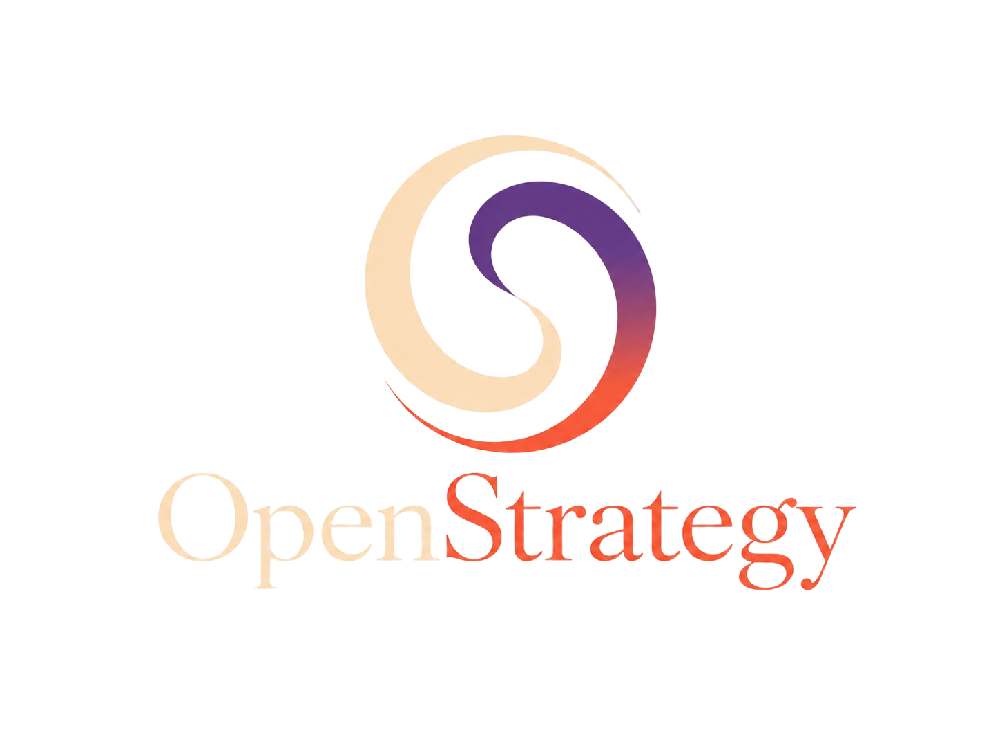
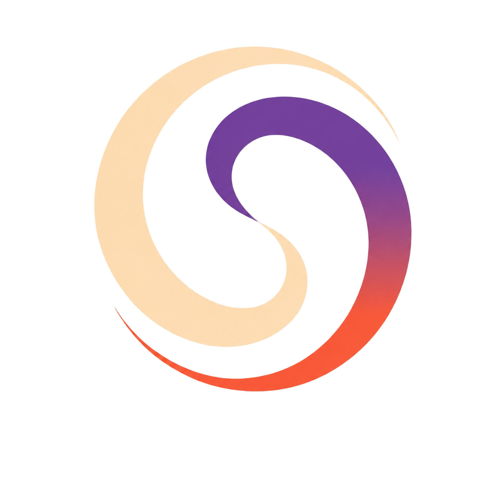
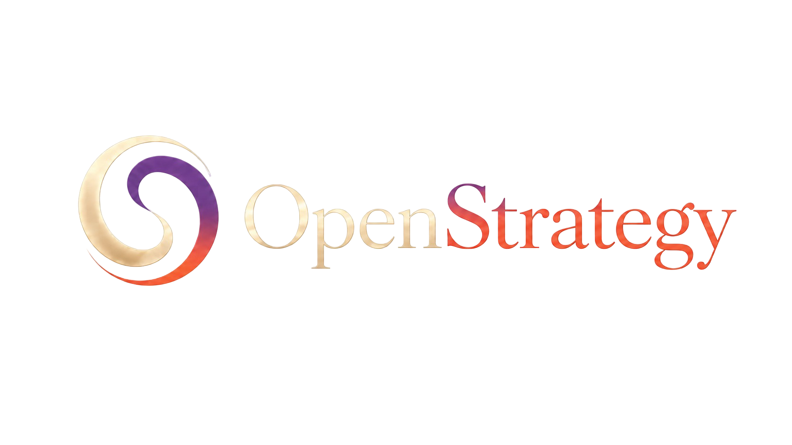
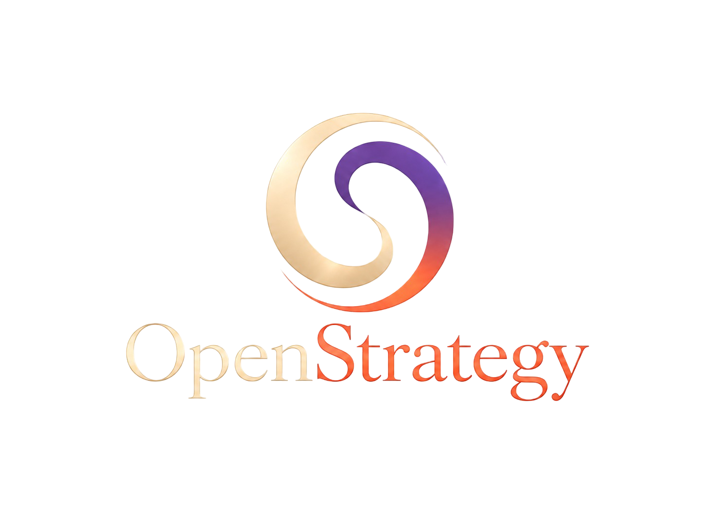

# OpenStrategy logo assets

Approved OpenStrategy logos, ready to pick and download. All files are transparent PNGs (RGBA). Right-click any download link and save, or use the raw URL directly in a form, deck or integration.

Base raw URL: `https://raw.githubusercontent.com/teojh9413/openstrategy-public/main/brand/`

## Flat (operational)

Use for navigation, app UI, documents, metadata and anything at small size.

| Preview | Asset | Size | Download |
| --- | --- | --- | --- |
|  | Horizontal lockup | 2172 × 724 | [openstrategy-lockup-horizontal-flat.png](https://raw.githubusercontent.com/teojh9413/openstrategy-public/main/brand/openstrategy-lockup-horizontal-flat.png) |
|  | Stacked lockup | 1448 × 1086 | [openstrategy-lockup-stacked-flat.png](https://raw.githubusercontent.com/teojh9413/openstrategy-public/main/brand/openstrategy-lockup-stacked-flat.png) |
|  | Icon (square) | 1254 × 1254 | [openstrategy-icon-flat.png](https://raw.githubusercontent.com/teojh9413/openstrategy-public/main/brand/openstrategy-icon-flat.png) |

## Effects (presentation)

Use for hero surfaces, report covers, deck covers and launch creative, at a readable size.

| Preview | Asset | Size | Download |
| --- | --- | --- | --- |
|  | Horizontal lockup | 1672 × 941 | [openstrategy-lockup-horizontal-effects.png](https://raw.githubusercontent.com/teojh9413/openstrategy-public/main/brand/openstrategy-lockup-horizontal-effects.png) |
|  | Stacked lockup | 1448 × 1086 | [openstrategy-lockup-stacked-effects.png](https://raw.githubusercontent.com/teojh9413/openstrategy-public/main/brand/openstrategy-lockup-stacked-effects.png) |
|  | Icon (square) | 1254 × 1254 | [openstrategy-icon-effects.png](https://raw.githubusercontent.com/teojh9413/openstrategy-public/main/brand/openstrategy-icon-effects.png) |

## Palette

Midnight `#03030F` · Champagne `#F3D9B6` · Deep purple `#673F87` · Coral `#E5573C`

## Usage

Write `OpenStrategy` as one continuous word. Do not recolour, filter, distort, crop, trace into SVG, flatten onto black, or regenerate these files. If a form asks for one logo URL, use the flat square icon:

```
https://raw.githubusercontent.com/teojh9413/openstrategy-public/main/brand/openstrategy-icon-flat.png
```
